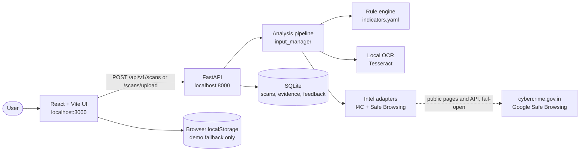
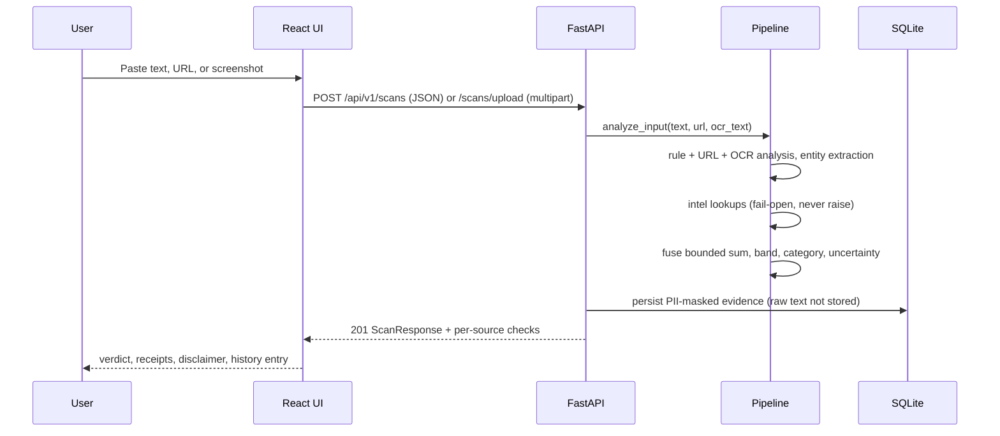

<div align="center">

# 🛡️ Scam Shield AI

**Paste it. Link it. Screenshot it. Know the signals before you act.**

Scam Shield AI is an explainable, privacy-aware scam-signal scanner. It inspects suspicious
messages, links, and screenshots, scores the risk indicators it can actually see, and shows
its work — every point traced back to a named, human-readable receipt.

<a href="https://www.python.org/">
  
</a>
<a href="https://fastapi.tiangolo.com/">
  
</a>
<a href="https://react.dev/">
  
</a>
<a href="https://www.typescriptlang.org/">
  
</a>
<a href="https://vitejs.dev/">
  
</a>
<a href="https://www.sqlite.org/">
  
</a>
<a href="https://docs.pytest.org/">
  
</a>
<a href="https://vitest.dev/">
  
</a>

<br />

[Overview](#overview) ·
[Key Features](#key-features) ·
[Demo](#screenshots-and-demo) ·
[Tech Stack](#technology-stack) ·
[Architecture](#architecture-and-workflow) ·
[Setup](#installation-and-local-setup) ·
[API](#api-reference) ·
[Testing](#testing-and-quality) ·
[Roadmap](#roadmap) ·
[Contributing](#contributing)

> **Status:** working local MVP under active development. Backend (247 tests) and
> frontend (21 tests) suites pass and the production build succeeds.

</div>

---

## Table of Contents

- [Overview](#overview)
- [Key Features](#key-features)
- [Screenshots and Demo](#screenshots-and-demo)
- [Technology Stack](#technology-stack)
- [Architecture and Workflow](#architecture-and-workflow)
- [Project Structure](#project-structure)
- [Installation and Local Setup](#installation-and-local-setup)
- [Environment Variables](#environment-variables)
- [API Reference](#api-reference)
- [Testing and Quality](#testing-and-quality)
- [Security and Responsible Use](#security-and-responsible-use)
- [Roadmap](#roadmap)
- [Contributing](#contributing)
- [License](#license)
- [Acknowledgements](#acknowledgements)
- [Contact](#contact)

---

## Overview

**What it is.** Scam Shield AI is a full-stack web application: a React frontend that
collects suspicious content, and a FastAPI backend that analyzes it with a transparent,
rule-based detection pipeline and stores a masked, reviewable history.

**Why it exists.** Phishing links, OTP and credential harvesting, fake job and internship
offers, upfront-fee fraud, and urgency-driven social engineering disproportionately hit
students and first-time internet users. Most “is this a scam?” moments happen in a chat
window, with seconds to decide and no tool that explains *why* something looks off.

**Who it is for.** Students and everyday users who want a second opinion on a message,
link, or screenshot — plus developers and reviewers who want to see exactly how each
risk score is derived.

**How it helps.** You paste a message, submit a URL, or upload a screenshot. The backend
extracts signals (urgency language, credential requests, brand lookalikes, suspicious URL
structure, and more), combines them into a bounded 0–100 score, assigns a risk band and
scam category, and returns each finding as an individual “receipt” with its point weight.
A 30-day scan history lets you revisit past checks without re-submitting content.

**Objectives and scope.** The goal is *explainable, privacy-respecting triage* — not a
verdict engine. Detection is rule-based (no ML model), single-user and local by design,
with no login and no paid services.

**Current limitations (stated plainly).**
- Risk bands are provisional and uncalibrated — the UI and API label the score as a
  heuristic, not a probability.
- Detection is English-pattern oriented; novel or non-English scams can be missed, and
  legitimate messages can be flagged.
- External checks are advisory only: I4C matches are similarity hints (weight 0), and
  Safe Browsing only runs when you provide your own API key.
- Record cleanup is timestamp-based (`expires_at` + 30 days) with a tested cleanup
  helper; there is no background scheduler in the running app.

---

## Key Features

🔍 **Multi-input scanning** — Paste a message (up to 10,000 chars), submit a URL
(up to 2,048 chars), or upload a screenshot. Uploads also accept optional
accompanying text or a URL in the same request. You get one unified result shape
for every input kind.

🧾 **Explainable receipts** — Every signal becomes an evidence item with an ID
(`CREDENTIAL_REQUEST`, `URL_BRAND_LOOKALIKE`, …), a plain-language reason, the
offending snippet, and its point weight. The score is exactly the bounded sum of
shown weights — verifiable, not magic.

📊 **Risk bands and categories** — Scores map to `LOW / MODERATE / HIGH / VERY_HIGH`
(or `UNCERTAIN` for thin input), with scam categories such as phishing, payment
scams, and fake-job patterns, plus per-band recommended next steps.

🖼️ **Local screenshot OCR** — Images are validated by content (never by filename),
sanitized to an EXIF-free image, read with on-machine Tesseract OCR, then discarded.
If Tesseract is missing you get a clear `OCR_UNAVAILABLE` error — never invented text.

🌐 **External intelligence, fail-open** — Official I4C advisories are matched locally
(similarity only, weight 0, nothing you submit leaves the machine), and Google Safe
Browsing confirms threat-list hits (weight 40) when you configure a key. Every source
reports what it did (`checked / disabled / skipped / unavailable / error`), and a
failed lookup never breaks the analysis.

🕘 **Scan history** — Past scans are listed newest-first with score, band, and summary;
opening one reloads the real stored analysis. Items can be deleted (with confirmation),
and feedback (“Was this read useful?”) is recorded per scan.

🔌 **Real API integration with honest fallback** — The UI talks to FastAPI by default
(`http://localhost:8000`, overridable via `VITE_API_BASE`). If the backend is
unreachable or returns a server error, the UI falls back to clearly labelled
`DEMO DATA` instead of pretending. Client errors (validation, rate limits) are shown
as errors, not silent fakes.

🛡️ **Privacy by default** — PII (phones, emails, ID-like numbers) is masked before
anything is stored; raw content is not stored by default; OCR text is never persisted;
uploaded images are never served back or retained.

---

## Screenshots and Demo

> **Placeholder.** No screenshots are checked into the repository yet. When UI captures
> are added, place them under `docs/screenshots/` and embed them here, for example:
>
> ```markdown
> 
> 
> 
> ```
>
> Until then, the fastest demo is running the stack locally (see
> [Installation](#installation-and-local-setup)) and opening the interactive API docs
> at `http://127.0.0.1:8000/docs`.

---

## Technology Stack

| Layer | Technology | Role |
|---|---|---|
| Frontend | **React 18 + TypeScript 5.6** | Scan / result / history views, client-side validation, toasts |
| Frontend | **Vite 6** | Dev server (`:3000`), production bundling |
| Frontend | **lucide-react** | Icon set used across the UI |
| Backend | **FastAPI 0.111 (Python 3.13)** | REST API, request validation, error shaping, OpenAPI docs |
| Backend | **Uvicorn** | ASGI server (`:8000`) |
| Backend | **Pydantic v2 + pydantic-settings** | Schemas and environment-driven configuration |
| Database | **SQLite + SQLAlchemy 2** | `scans`, `evidence`, and `feedback` tables; auto-created on startup |
| Detection | **Rule engine (`indicators.yaml`, 50+ documented indicators)** | Text/URL signal matching with weights and categories |
| Detection | **Tesseract OCR (pytesseract + Pillow)** | Local screenshot text extraction with confidence scores |
| Intelligence | **I4C advisories + Google Safe Browsing v4 (httpx)** | Advisory similarity and confirmed threat-list matches, fail-open |
| API glue | **Fetch + `VITE_API_BASE`** | UI-to-backend calls; multipart upload for screenshots |
| Rate limiting | **SlowAPI** | 30 requests/minute on write endpoints |
| Testing | **pytest + pytest-asyncio + httpx (backend)** | 10 test modules incl. API, DB, upload, privacy, intel suites |
| Testing | **Vitest + Testing Library + jsdom (frontend)** | API-client mapping and full app-flow tests incl. XSS escaping |

---

## Architecture and Workflow



How a scan flows, step by step:



Key design points: the image never reaches the database; source checks are returned
on creation but not persisted (history reads return `[]`); history detail rebuilds
module scores deterministically from stored evidence weights.

---

## Project Structure

```text
.
├── backend/
│   ├── app/
│   │   ├── main.py                # App, middleware (CORS, upload cap, request IDs), routers
│   │   ├── config.py              # Settings + tolerant ALLOWED_ORIGINS parsing
│   │   ├── ratelimit.py           # SlowAPI limiter wiring
│   │   ├── exceptions.py          # Uniform {"error": {"code", "message"}} handlers
│   │   ├── api/
│   │   │   ├── health.py          # GET /api/v1/health
│   │   │   └── scans.py           # Scan CRUD, upload, feedback endpoints
│   │   ├── db/
│   │   │   ├── models.py          # Scan, Evidence, Feedback tables
│   │   │   ├── repository.py      # Persistence incl. 30-day expiry + cleanup helper
│   │   │   └── session.py         # Engine + init_db (auto-creates tables)
│   │   ├── rules/
│   │   │   └── indicators.yaml    # Detection rule definitions
│   │   ├── schemas/
│   │   │   ├── request.py         # Scan/feedback input validation + limits
│   │   │   └── response.py        # ScanResponse, evidence, source checks
│   │   └── services/
│   │       ├── input_manager.py   # Pipeline entry point (analyze_input)
│   │       ├── text_analyzer.py   # Message signal matching
│   │       ├── url_analyzer.py    # Lexical URL analysis
│   │       ├── fusion.py          # Bounded-sum scoring, bands, categories
│   │       ├── explain.py         # Human-readable reasons, disclaimers
│   │       ├── evidence.py        # Entity extraction (URLs, emails, phones…)
│   │       ├── privacy.py         # PII masking before storage
│   │       ├── image_validator.py # Content sniffing, limits, EXIF-free sanitize
│   │       ├── ocr.py             # Local Tesseract runner (temp file deleted)
│   │       └── intel/             # External adapters: base, i4c, safebrowsing
│   ├── tests/                     # 11 pytest modules (API, DB, upload, intel…)
│   └── requirements.txt           # Pinned backend dependencies
├── frontend/
│   ├── src/
│   │   ├── App.tsx                # Scan / result / history views
│   │   ├── main.tsx               # React entry point
│   │   ├── styles.css             # Full UI styling
│   │   ├── lucide.d.ts            # Icon type shim
│   │   ├── vite-env.d.ts          # Vite env typings (VITE_API_BASE)
│   │   ├── App.test.tsx           # App-flow tests (incl. XSS escaping check)
│   │   └── lib/
│   │       ├── api.ts             # Backend client, mapping, demo fallback
│   │       └── api.test.ts        # Client mapping + error-shape tests
│   ├── index.html                 # App shell + metadata
│   ├── package.json               # Scripts: dev / build / test / preview
│   ├── vite.config.ts             # React plugin + jsdom test setup
│   └── tsconfig.json              # Strict type-checking (runs in build)
├── docs/
│   ├── API.md                     # Full endpoint + error-code reference
│   └── ASSUMPTIONS.md             # Reversible stack/scope decisions log
├── .env.example                   # Safe placeholder configuration template
└── README.md                      # This file
```

Generated and local-only paths (`node_modules/`, `.venv/`, `dist/`, caches,
`*.db`, `.env`) are git-ignored and intentionally absent from the repo.

---

## Installation and Local Setup

### 1. Prerequisites

| Requirement | Minimum | Verified with |
|---|---|---|
| Python | 3.11+ | Python 3.13.7 |
| Node.js (with npm) | 18+ | Node v24.15.0, npm 11.12.1 |
| Tesseract OCR | system install (see below) | auto-detected install |

Install Tesseract for screenshot OCR (text and URL analysis work without it):

- **Windows (PowerShell):** `winget install UB-Mannheim.TesseractOCR` — or the
  installer from `https://github.com/UB-Mannheim/tesseract/wiki`. If it is not on
  `PATH`, set `TESSERACT_CMD` in `.env` to the full `tesseract.exe` path.
- **macOS:** `brew install tesseract`
- **Linux:** `sudo apt install tesseract-ocr`

Without Tesseract, uploads return a clear `OCR_UNAVAILABLE` error instead of
fabricated text.

### 2. Clone the repository

```bash
git clone https://github.com/Mayank1903mishra/Scam-Sheild-Ai.git
cd Scam-Sheild-Ai
```

### 3. Set up the backend environment

Windows PowerShell:

```powershell
cd backend
python -m venv .venv
.\.venv\Scripts\Activate.ps1
pip install -r requirements.txt
```

Linux/macOS:

```bash
cd backend
python -m venv .venv
source .venv/bin/activate
pip install -r requirements.txt
```

### 4. Configure environment variables

```bash
cp ../.env.example .env     # read from backend/.env (repo-root ../.env also works)
```

The shipped defaults run out of the box. See [Environment Variables](#environment-variables)
for every setting — all secrets are empty placeholders.

### 5. Database

No migrations needed: SQLite tables (`scans`, `evidence`, `feedback`) are created
automatically when the backend starts. Default file: `backend/scamshield.db`
(override with `DATABASE_URL`).

### 6. Start the backend

```bash
uvicorn app.main:app --reload
```

Backend serves on `http://127.0.0.1:8000`. Interactive docs (development mode):
`http://127.0.0.1:8000/docs`.

### 7. Install frontend dependencies and start the frontend

In a second terminal:

```bash
cd frontend
npm install
npm run dev
```

The UI serves on `http://localhost:3000` and calls the backend at
`http://localhost:8000` by default. To use another backend:

```bash
VITE_API_BASE=http://localhost:9000 npm run dev
```

### 8. Verify it works

1. Open `http://localhost:3000`.
2. Check backend health: `http://127.0.0.1:8000/api/v1/health` should return
   `{"status":"ok","version":"0.1.0","mode":"rules"}`.
3. Paste a suspicious message and scan — the result view shows the verdict,
   evidence receipts, disclaimer, and external source checks.

Start the backend first, then the frontend.

---

## Environment Variables

| Variable | Purpose | Required | Example | Notes |
|---|---|---|---|---|
| `APP_ENV` | `development` enables `/docs` and `/redoc` | No (default `development`) | `development` | Set `production` to hide API docs |
| `DATABASE_URL` | SQLite database location | No (default `sqlite:///./scamshield.db`) | `sqlite:///./scamshield.db` | File is git-ignored |
| `MAX_UPLOAD_MB` | Screenshot size cap | No (default `5`) | `5` | Oversized bodies rejected pre-parse with `413` |
| `MAX_IMAGE_PIXELS` | Pixel-count bomb protection | No (default `25000000`) | `25000000` | `413 IMAGE_TOO_LARGE` when exceeded |
| `MAX_IMAGE_DIMENSION` | Max image width/height | No (default `10000`) | `10000` | Checked before decoding |
| `TESSERACT_CMD` | Full path to `tesseract.exe` | No (empty = auto-detect) | `C:\Program Files\Tesseract-OCR\tesseract.exe` | Auto-detects `PATH` + common locations |
| `OCR_TIMEOUT_SECONDS` | OCR time budget | No (default `30`) | `30` | Slow OCR fails safe, not silent |
| `ALLOWED_ORIGINS` | Browser CORS allow-list | No (defaults cover `:3000`/`:5173` + `127.0.0.1`) | `http://localhost:5173,http://localhost:3000` | Comma-separated or JSON array |
| `INTEL_LOOKUPS_ENABLED` | Master switch for external checks | No (default `true`) | `true` | `false` reports both sources `disabled`, zero requests |
| `INTEL_TIMEOUT_SECONDS` | Per-source network budget | No (default `3`) | `3` | Timeouts are cached briefly, fail open |
| `INTEL_CACHE_SECONDS` | Advisory cache TTL | No (default `1800`) | `1800` | Failures cached 60s to avoid stalling scans |
| `GOOGLE_SAFE_BROWSING_API_KEY` | Safe Browsing v4 key | No (empty = source `disabled`) | *(leave empty unless you have one)* | Never committed; no request is made without it |
| `I4C_ADVISORY_URL` / `I4C_DIGEST_URL` | Override official I4C pages | No (defaults to cybercrime.gov.in pages) | *(defaults are fine)* | Read-only public pages |
| `RETENTION_DAYS` | Record expiry window | No (default `30`) | `30` | Rows carry `expires_at`; cleanup helper is tested |
| `STORE_CONTENT` | Keep masked user content | No (default `false`) | `false` | Raw text is never stored when `false` |
| `DEMO_MODE` | Demo label switch | No (default `false`) | `false` | `true` reports `/health` mode as `demo` |
| `RATE_LIMIT` | Write-endpoint throttle | No (default `30/minute`) | `30/minute` | SlowAPI; excess returns `429 RATE_LIMITED` |

---

## API Reference

Base URL: `http://127.0.0.1:8000`. All routes live under `/api/v1`.
**Authentication: none** — the app is a local single-user design by intent.
Every response includes an `X-Request-ID` header; every error uses
`{"error": {"code", "message"}}`. Full schema reference: [`docs/API.md`](docs/API.md).

| Method | Route | Purpose | Key inputs | Response |
|---|---|---|---|---|
| `GET` | `/api/v1/health` | Liveness + mode | — | `{status, version, mode}` |
| `POST` | `/api/v1/scans` | Analyze text and/or URL | `text` (1–10,000), `url` (1–2,048); at least one required | `201` full scan result |
| `POST` | `/api/v1/scans/upload` | OCR a screenshot + optional text/URL | multipart `file` (PNG/JPEG/WebP ≤ 5 MB) | `201` result incl. `ocr_text` |
| `GET` | `/api/v1/scans?limit=&offset=` | History, newest first | `limit` (default 50), `offset` | List items (no raw content) |
| `GET` | `/api/v1/scans/{id}` | Full stored analysis | UUID path | Detail (sources `[]`, modules recomputed) |
| `DELETE` | `/api/v1/scans/{id}` | Delete a scan + children | UUID path | `204`, or `404` |
| `POST` | `/api/v1/scans/{id}/feedback` | Record helpful/not-helpful | `{helpful, comment?}` | `{message}` or `404` |

Common error codes: `VALIDATION_ERROR` (422) · `HTTP_ERROR` (404) ·
`INVALID_IMAGE` (400) · `FILE_TOO_LARGE` / `IMAGE_TOO_LARGE` (413) ·
`UNSUPPORTED_FILE_TYPE` (415) · `RATE_LIMITED` (429) ·
`OCR_UNAVAILABLE` / `OCR_FAILED` (503) · `INTERNAL_ERROR` (500, no stack leaked).

PowerShell examples:

```powershell
# Health
Invoke-RestMethod -Uri http://127.0.0.1:8000/api/v1/health

# Text scan
$body = @{ text = 'Your account will be blocked today. Send the OTP now to verify.' } | ConvertTo-Json
Invoke-RestMethod -Method Post -Uri http://127.0.0.1:8000/api/v1/scans `
  -Body $body -ContentType 'application/json'

# URL scan
$body = @{ url = 'http://paypa1-secure-login.verify-account.xyz/reset' } | ConvertTo-Json
Invoke-RestMethod -Method Post -Uri http://127.0.0.1:8000/api/v1/scans `
  -Body $body -ContentType 'application/json'

# Screenshot upload
curl.exe -s -X POST http://127.0.0.1:8000/api/v1/scans/upload -F "file=@screenshot.png"
```

> Note for PowerShell users: pass JSON to `curl.exe` via a file
> (`--data-binary "@payload.json"`). Inline `-d '{"text":...}'` is mangled by
> PowerShell quoting and returns `422 JSON decode error`.

---

## Testing and Quality

```bash
# Backend: 10 pytest modules (API, DB, upload, privacy, intel, config, edge cases)
cd backend
.\.venv\Scripts\python -m pytest tests/ -q        # Windows
python -m pytest tests/ -q                        # Linux/macOS

# Frontend: 2 vitest suites, then typecheck + production build
cd frontend
npm test
npm run build
```

Latest reverified results: **backend 247 passed · frontend 21 passed · production
build successful.** Suites cover the score invariant
(`risk_score == min(100, max(0, Σ evidence weights))`), PII masking before
persistence, upload rejection paths, rate-limit isolation, intel fail-open
behaviour, API-client mapping, full app flows, and an XSS escaping check
(malicious snippets render as text, never as markup). No coverage percentages are
claimed.

---

## Security and Responsible Use

- **Advisory, not authoritative.** The score is a heuristic over visible signals.
  False positives happen; novel scams are missed. Always verify important
  communications through official channels.
- **Uploads are hostile until proven otherwise.** Files are sniffed by content
  (magic bytes, never extension), size- and pixel-capped before decoding, re-encoded
  to EXIF-free PNG, OCR'd from a random temp file that is always deleted, and never
  persisted or served back.
- **Data minimization.** PII is masked before storage; raw content is not stored by
  default (`STORE_CONTENT=false`); OCR text is never persisted; history lists carry
  no raw content.
- **Input discipline.** Strict length caps (10,000 / 2,048 chars), Pydantic
  validation, multipart pre-parse size middleware, and per-minute rate limits on
  write endpoints.
- **Secret hygiene.** API keys live only in local `.env` (git-ignored, empty by
  default); `.env.example` ships placeholders exclusively.
- **Failure posture.** External lookups fail open and report themselves; unexpected
  server errors return a clean `INTERNAL_ERROR` with a request ID and no stack trace.

This tool does not guarantee protection against any scam and does not replace
official reporting channels (e.g. cybercrime.gov.in) or professional security advice.

---

## Roadmap

**Completed and verified**
- Text, URL, and screenshot analysis with a unified result schema
- Bounded explainable scoring with bands, categories, and per-band guidance
- Local Tesseract OCR with confidence + clear unavailable/failure errors
- I4C advisory similarity and Safe Browsing confirmed-match intelligence, fail-open
- Scan history, detail reload, delete, and per-scan feedback
- Rate limiting, CORS allow-list, uniform errors, request IDs, interactive docs
- 268 automated tests + production build, all green

**Proposed (not implemented)**
- Record-expiry scheduler (timestamps + tested helper exist; no background sweeper yet)
- Calibration of the provisional risk bands against evaluated data
- Multilingual and regional-scam pattern coverage
- Richer history analytics and export
- Deployment automation (Docker / CI) and hosted demo
- A checked-in `LICENSE` file (none exists yet — see below)

---

## Contributing

Contributions are welcome — bug reports, new scam-pattern rules, UI improvements,
tests, and docs.

1. Fork the repo and create a focused branch (`fix/...`, `feat/...`, `docs/...`).
2. For backend changes, add or extend tests under `backend/tests/`; for UI changes,
   cover them in `frontend/src/*.test.*`.
3. Verify before opening a PR: backend `pytest`, frontend `npm test`, and
   `npm run build` must all pass.
4. Open a pull request describing what changed, why, and how you verified it.

Report bugs or request features via
[GitHub Issues](https://github.com/Mayank1903mishra/Scam-Sheild-Ai/issues) with
steps to reproduce, expected vs. actual behaviour, and relevant request IDs or
(redacted) payloads — never paste real credentials, OTPs, or personal data.

---

## License

No license file is present in this repository yet, so no license is claimed here.
Until one is added, all rights remain with the project owner. If you reuse this
code, ask the owner to add an explicit open-source license first.

---

## Acknowledgements

- [FastAPI](https://fastapi.tiangolo.com/), [Uvicorn](https://www.uvicorn.org/),
  [Pydantic](https://docs.pydantic.dev/), [SQLAlchemy](https://www.sqlalchemy.org/)
- [React](https://react.dev/), [Vite](https://vitejs.dev/),
  [TypeScript](https://www.typescriptlang.org/),
  [lucide-react](https://lucide.dev/), [Testing Library](https://testing-library.com/)
- [Tesseract OCR](https://github.com/tesseract-ocr/tesseract) and the
  [UB-Mannheim builds](https://github.com/UB-Mannheim/tesseract/wiki) for Windows
- [I4C / cybercrime.gov.in](https://cybercrime.gov.in/) public advisories and
  [Google Safe Browsing](https://developers.google.com/safe-browsing/) for threat intelligence
- [pytest](https://docs.pytest.org/), [Vitest](https://vitest.dev/),
  [SlowAPI](https://github.com/laurentS/slowapi)

---

## Contact

Questions, ideas, or security-relevant findings: please use
[GitHub Issues](https://github.com/Mayank1903mishra/Scam-Sheild-Ai/issues).
Do not share passwords, OTPs, tokens, or personal information in issues.

---

<div align="center">

**Scam Shield AI** — *read the signals, not the fear.*

⭐ Star the repo if it helped you · 🐞 Report what it gets wrong · 🤝 PRs welcome

</div>
